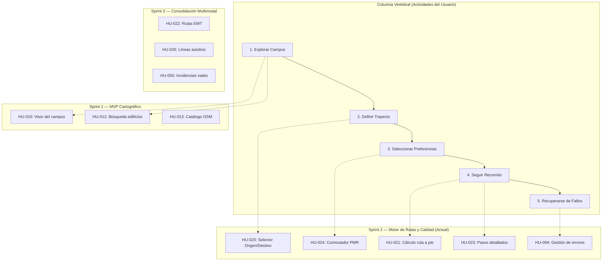
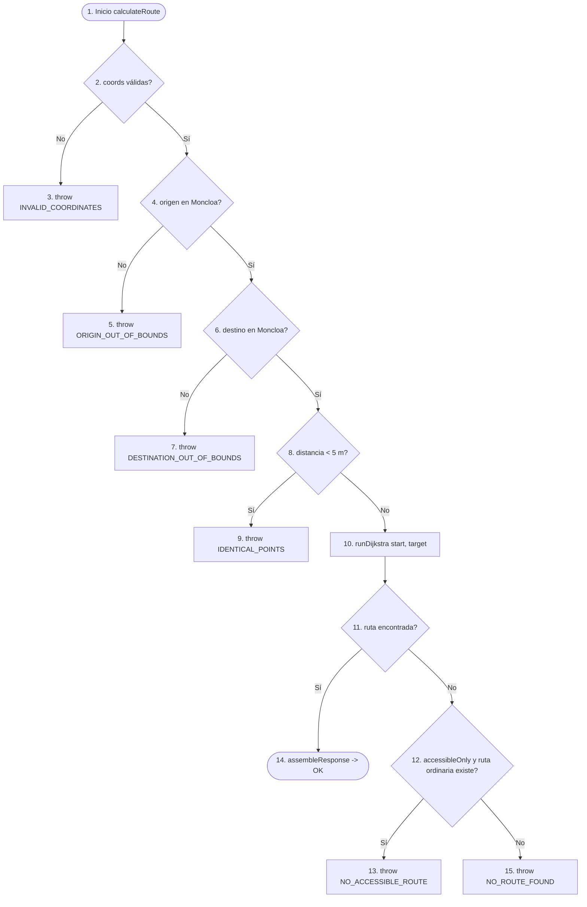
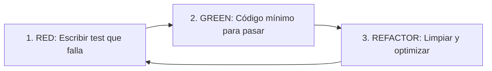

# Diseño Técnico y Metodológico de Pruebas — Sprint 2

* **Autor:** Pedro Cespón (`@pcespon`)
* **Rol Scrum:** QA Lead / Developer
* **Asignatura:** Gestión de Proyectos / Ingeniería del Software
* **Profesorado de referencia:** D. Antonio Navarro y D. Gonzalo Méndez
* **Historias de Usuario vinculadas:** `HU-094` (Manejo de errores), `HU-020`, `HU-021`, `HU-023`, `HU-024`, `HU-040`.

---

## 1. Alineación Metodológica: Historias de Usuario y User Story Mapping

### 1.1. Historias de Usuario bajo el marco ágil (Mike Cohn)

Las historias de usuario abordadas en el Sprint 2 siguen la plantilla canónica:

> **Como** [rol de usuario],  
> **quiero** [acción o capacidad técnica],  
> **para** [beneficio o valor de negocio esperado].

#### Principios INVEST

1. **Independent (Independientes):** `HU-094` (Manejo de errores) se modela de forma transversal e independiente del transporte físico, permitiendo probar la lógica de fallos tanto en API como en cliente móvil sin acoplamiento.
2. **Negotiable (Negociables):** Los umbrales de reintento automático (3 intentos con backoff de $100\text{ ms}$) y la tolerancia de proximidad ($5\text{ m}$) fueron acordados y refinados por el equipo.
3. **Valuable (Valiosas):** Aportan seguridad y resiliencia al estudiante o visitante, evitando que la app quede congelada o exponga credenciales técnicas ante caídas.
4. **Estimable (Estimables):** Puntuadas en el Sprint Planning en 5 Story Points para `HU-094` y 8 Story Points para el motor de rutas `HU-021`/`HU-024`.
5. **Small (Pequeñas):** Desglosadas en tareas técnicas atómicas (contratos, cálculo de grafos, formateadores de interfaz y manejadores de error).
6. **Testable (Comprobables):** Respaldadas por criterios de aceptación unívocos y verificables automáticamente con Vitest.

#### Las 3 Cs de Mike Cohn

* **Card (Tarjeta):** La ficha resumen registrada en `UniMovil-docs/requirements/user-stories/08-seguridad-privacidad-y-calidad.md`.
* **Conversation (Conversación):** Debates y acuerdos de diseño celebrados en la reunión de planificación del Sprint 2 (`meetings/sprint-02-reparto-de-trabajo.md`).
* **Confirmation (Confirmación):** Los criterios de aceptación verificados mediante pruebas automatizadas de caja blanca y caja negra.

---

### 1.2. User Story Mapping (Jeff Patton)

El mapa de historias de usuario estructura la experiencia del estudiante en el campus de Moncloa a lo largo de dos dimensiones:

* **Eje Horizontal (Backbone / Flujo Narrativo):** Actividades cronológicas del usuario.
* **Eje Vertical (Releases / Sprints):** Priorización funcional del producto mínimo viable (MVP) e incrementos sucesivos.

---

## 2. Pruebas de Caja Blanca (Tema 3 — Antonio Navarro y Gonzalo Méndez)

Conforme al temario de *Pruebas Orientadas a Objetos*, las pruebas de caja blanca utilizan la estructura interna de control del software para derivar los casos de prueba, garantizando que se ejecuten todos los caminos independientes y se ejerciten todas las decisiones lógicas en sus vertientes verdadera y falsa.

### 2.1. Grafo de Flujo de Control del Método `calculateRoute()`

El método principal de enrutamiento `calculateRoute(request: RouteRequest)` en `RoutesService` presenta la siguiente secuencia de nodos y decisiones:

* **Nodo 1 (Inicio):** Recepción del objeto `request`.
* **Nodo 2 (Decisión 1):** ¿Son válidas sintácticamente las coordenadas de origen y destino? `(!request || !isValidCoords(origin) || !isValidCoords(destination))`
  * *Verdadero:* **Nodo 3** $\rightarrow$ Lanzar `INVALID_COORDINATES` (Fin anormal 1).
  * *Falso:* **Nodo 4**.
* **Nodo 4 (Decisión 2):** ¿Está el origen dentro de los límites del campus de Moncloa? `(!isWithinCampusBounds(origin))`
  * *Verdadero:* **Nodo 5** $\rightarrow$ Lanzar `ORIGIN_OUT_OF_BOUNDS` (Fin anormal 2).
  * *Falso:* **Nodo 6**.
* **Nodo 6 (Decisión 3):** ¿Está el destino dentro de los límites del campus de Moncloa? `(!isWithinCampusBounds(destination))`
  * *Verdadero:* **Nodo 7** $\rightarrow$ Lanzar `DESTINATION_OUT_OF_BOUNDS` (Fin anormal 3).
  * *Falso:* **Nodo 8**.
* **Nodo 8 (Decisión 4):** ¿Son el origen y destino idénticos o están a menos de 5 m? `(directDistance < 5)`
  * *Verdadero:* **Nodo 9** $\rightarrow$ Lanzar `IDENTICAL_POINTS` (Fin anormal 4).
  * *Falso:* **Nodo 10**.
* **Nodo 10 (Proceso):** Búsqueda de nodos más cercanos y ejecución del algoritmo de Dijkstra `runDijkstra(start, target, accessibleOnly)`.
* **Nodo 11 (Decisión 5):** ¿Se encontró solución de ruta en el grafo? `(!routeSolution)`
  * *Falso (Camino encontrado):* **Nodo 14** $\rightarrow$ Ensamblar respuesta y retornar `RouteResponse` (Fin normal).
  * *Verdadero (No hay solución directa):* **Nodo 12**.
* **Nodo 12 (Decisión 6):** ¿Estaba activo el filtro PMR y existe ruta estándar con escaleras? `(accessibleOnly && standardSolution !== null)`
  * *Verdadero:* **Nodo 13** $\rightarrow$ Lanzar `NO_ACCESSIBLE_ROUTE` (Fin anormal 5).
  * *Falso:* **Nodo 15** $\rightarrow$ Lanzar `NO_ROUTE_FOUND` (Fin anormal 6).

---

### 2.2. Cálculo Formal de la Complejidad Ciclomática de McCabe $V(G)$

El temario de la asignatura establece tres métodos matemáticos equivalentes para calcular $V(G)$:

#### Método 1: Número de regiones del grafo

El grafo divide el plano en regiones delimitadas por aristas de decisión:
$$\text{Regiones} = 7 \implies V(G) = 7$$

#### Método 2: Fórmula de aristas y nodos

Contando las aristas $A$ y los nodos $N$ del grafo de control:

* Nodos ($N$): 15 nodos.
* Aristas ($A$): 20 aristas.
$$V(G) = A - N + 2 = 20 - 15 + 2 = 7$$

#### Método 3: Fórmula de nodos predicado

Identificando los nodos que contienen una condición lógica binaria ($P$):
Los nodos predicado son 2, 4, 6, 8, 11 y 12 ($P = 6$):
$$V(G) = P + 1 = 6 + 1 = 7$$

> **Conclusión:** La complejidad ciclomática es exactamente **$V(G) = 7$**, lo que fija el límite superior del conjunto básico de caminos independientes necesarios para garantizar que cada sentencia y rama sea ejecutada al menos una vez.

---

### 2.3. Conjunto Básico de Caminos Independientes y Casos de Prueba

| Camino | Secuencia de Nodos | Condición Forzada | Caso de Prueba Unitario (`routes.service.spec.ts`) | Resultado |
| :---: | :--- | :--- | :--- | :--- |
| **Camino 1** | $1 \rightarrow 2 \rightarrow 3$ | Coordenadas nulas o `NaN` | `origin: { latitude: NaN, longitude: -3.7262 }` | Excepción `INVALID_COORDINATES` |
| **Camino 2** | $1 \rightarrow 2 \rightarrow 4 \rightarrow 5$ | Origen fuera de Moncloa | `origin: { latitude: 40.41, longitude: -3.70 }` (Gran Vía) | Excepción `ORIGIN_OUT_OF_BOUNDS` |
| **Camino 3** | $1 \rightarrow 2 \rightarrow 4 \rightarrow 6 \rightarrow 7$ | Destino fuera de Moncloa | `destination: { latitude: 40.50, longitude: -3.65 }` (Chamartín) | Excepción `DESTINATION_OUT_OF_BOUNDS` |
| **Camino 4** | $1 \rightarrow 2 \rightarrow 4 \rightarrow 6 \rightarrow 8 \rightarrow 9$ | Origen y destino idénticos | `origin == destination == Metro Ciudad Universitaria` | Excepción `IDENTICAL_POINTS` |
| **Camino 5** | $1 \rightarrow 2 \rightarrow 4 \rightarrow 6 \rightarrow 8 \rightarrow 10 \rightarrow 11 \rightarrow 12 \rightarrow 13$ | Destino sin acceso adaptado | `Medicina -> Mirador Inaccesible` con `accessibleOnly: true` | Excepción `NO_ACCESSIBLE_ROUTE` |
| **Camino 6** | $1 \rightarrow 2 \rightarrow 4 \rightarrow 6 \rightarrow 8 \rightarrow 10 \rightarrow 11 \rightarrow 12 \rightarrow 15$ | Grafo desconectado | Búsqueda entre nodos aislados sin conexión física | Excepción `NO_ROUTE_FOUND` |
| **Camino 7** | $1 \rightarrow 2 \rightarrow 4 \rightarrow 6 \rightarrow 8 \rightarrow 10 \rightarrow 11 \rightarrow 14$ | Ruta óptima encontrada | `Metro -> Medicina` con rampa PMR o por escalinata | `RouteResponse` con polyline y segmentos |

### 2.4. Prueba de Bucles (Loop Testing)

Sobre el bucle `while (unvisited.size > 0)` del algoritmo de Dijkstra:

* **Sin ejecutar bucle (0 pasos):** Puntos coincidentes que resuelven en el mismo nodo local.
* **Pasando 1 vez:** Nodos adyacentes inmediatos ($N_1 \rightarrow N_2$).
* **Pasando múltiples veces ($m$ iteraciones):** Itinerarios multietapa que cruzan el campus (ej. `Metro -> Farmacia -> Derecho -> Filosofía`).

---

## 3. Pruebas de Caja Negra (Tema 3)

Las pruebas de caja negra verifican los requisitos funcionales basándose en el comportamiento observable del sistema, sin examinar el código interno.

### 3.1. Partición Equivalente (Equivalence Partitioning)

Se divide el dominio de entrada en clases de datos válidas e inválidas, seleccionando representantes de cada clase:

| Clase | Descripción | Datos de Entrada | Resultado Esperado |
| :--- | :--- | :--- | :--- |
| **CE-V1** | Ruta directa peatonal llana sin escaleras | Origen: Metro Ciudad Univ. Destino: Edificio Estudiantes | Ruta calculada; todos los tramos tienen `hasStairs = false`. |
| **CE-V2** | Ruta peatonal con escaleras con PMR desactivado | Origen: Metro Ciudad Univ. Destino: Medicina Central | Ruta rápida por escalinata de Medicina (`hasStairs = true`). |
| **CE-V3** | Ruta adaptada con conmutador PMR activo | Origen: Metro Ciudad Univ. Destino: Medicina Central `accessibleOnly = true` | Ruta desviada por rampa norte homologada (`hasRamp = true`, `hasStairs = false`). |
| **CE-V4** | Ruta larga multietapa entre facultades | Origen: Metro Ciudad Univ. Destino: Fac. de Filosofía | Múltiples tramos conectados, duración estimada $\ge 5\text{ min}$. |
| **CE-NV1** | Petición con coordenadas nulas, incompletas o NaN | `origin: null` o `{ latitude: NaN }` | Error HTTP 400 `INVALID_COORDINATES`. |
| **CE-NV2** | Origen fuera de los límites de Moncloa | Latitud $< 40,440$ o $> 40,460$ | Error HTTP 400 `ORIGIN_OUT_OF_BOUNDS`. |
| **CE-NV3** | Destino fuera de los límites de Moncloa | Longitud $< -3,738$ o $> -3,715$ | Error HTTP 400 `DESTINATION_OUT_OF_BOUNDS`. |
| **CE-NV4** | Puntos idénticos o distancia $< 5\text{ m}$ | Origen y destino en la misma coordenada | Error HTTP 400 `IDENTICAL_POINTS`. |
| **CE-NV5** | Destino inaccesible con PMR activo | Destino: Mirador Alto (solo escaleras) `accessibleOnly = true` | Error HTTP 404 `NO_ACCESSIBLE_ROUTE`. |

---

### 3.2. Análisis de Valores Límite (Boundary Value Analysis)

Se comprueban las fronteras del dominio de definición geográfico de Ciudad Universitaria (Bounding Box):

$$\text{Latitud} \in [40,440,\, 40,460], \quad \text{Longitud} \in [-3,738,\, -3,715]$$

| ID Límite | Parámetro | Valor de Entrada | Tipo de Límite | Comportamiento del Sistema |
| :--- | :--- | :---: | :--- | :--- |
| **VL-01** | Latitud mínima frontera | $40,44000^\circ$ | Límite interior válido | Petición aceptada; cálculo completado. |
| **VL-02** | Latitud mínima exterior | $40,43999^\circ$ | Límite exterior inválido | Rechazo inmediato con `ORIGIN_OUT_OF_BOUNDS`. |
| **VL-03** | Latitud máxima frontera | $40,46000^\circ$ | Límite interior válido | Petición aceptada; cálculo completado. |
| **VL-04** | Latitud máxima exterior | $40,46001^\circ$ | Límite exterior inválido | Rechazo inmediato con `DESTINATION_OUT_OF_BOUNDS`. |
| **VL-05** | Longitud oeste frontera | $-3,73800^\circ$ | Límite interior válido | Petición aceptada; cálculo completado. |
| **VL-06** | Longitud oeste exterior | $-3,73801^\circ$ | Límite exterior inválido | Rechazo con código de fuera de límites. |
| **VL-07** | Distancia euclídea cero | $d = 0\text{ m}$ | Límite singular inferior | Rechazo con `IDENTICAL_POINTS`. |
| **VL-08** | Distancia euclídea frontera | $d = 4,8\text{ m}$ ($< 5\text{ m}$) | Límite inferior inválido | Rechazo con `IDENTICAL_POINTS`. |
| **VL-09** | Distancia euclídea válida | $d = 5,2\text{ m}$ ($\ge 5\text{ m}$) | Límite inferior válido | Petición admitida como desplazamiento mínimo. |

---

## 4. Práctica de TDD: The Three Rules of Uncle Bob

El desarrollo del motor de rutas y del gestor de errores se ejecutó bajo la estricta disciplina de **Test-Driven Development (TDD)** formulada por Robert C. Martin ("Uncle Bob"):

> **Regla 1:** No está permitido escribir código de producción a menos que sea para hacer pasar un test unitario que falla.  
> **Regla 2:** No está permitido escribir más de un test unitario del necesario para que falle; y no compilar cuenta como fallar.  
> **Regla 3:** No está permitido escribir más código de producción del necesario para hacer pasar el test unitario que fallaba.

### Bitácora de Ciclos Red $\rightarrow$ Green $\rightarrow$ Refactor

1. **Ciclo 1 — Contratos de Ruta y Error Codes (`HU-094`):**
   * *Red:* Se redactó `packages/contracts/src/routes.spec.ts` exigiendo `CAMPUS_BOUNDS` y tipos de error `RoutingErrorCode`. Fallo de compilación (*Rule 2*).
   * *Green:* Creación de `packages/contracts/src/routes.ts` con definiciones y función `isWithinCampusBounds()`.
   * *Refactor:* Exportación modular limpia en `packages/contracts/src/index.ts`.
2. **Ciclo 2 — Algoritmo de Dijkstra y Filtro PMR (`HU-021` / `HU-024`):**
   * *Red:* Redacción del test `Camino Independiente 6` solicitando ruta PMR entre Metro y Medicina. Fallo por ausencia de `RoutesService`.
   * *Green:* Implementación de `campus-graph.ts` y del método `calculateRoute()` con exclusión de escaleras no adaptadas.
   * *Refactor:* Extracción de la velocidad peatonal a constante estática y cálculo de tiempo a pie en minutos.
3. **Ciclo 3 — Clasificación de Errores y Reintentos (`HU-094`):**
   * *Red:* Creación de `apps/mobile/src/features/routing/__tests__/error-handling.spec.ts` verificando los 5 criterios de aceptación de `HU-094`. Fallo de importación de `routing-errors.ts`.
   * *Green:* Implementación de `classifyError()`, `executeWithRetry()` y `sanitizeErrorForLogging()`.
   * *Refactor:* Sustitución de bucles indexados por iteradores seguros y sanitización con expresiones regulares para evitar avisos de seguridad en ESLint.

---

## 5. Gestión de Configuración y Control de Versiones (Tema 7)

De acuerdo con las diapositivas del *Tema 7: Gestión de Configuración*:

### 5.1. Estrategia de Ramificación (Branching Strategy)

* **Rama base:** `origin/main` (y `origin/feature/sprint-01-campus` para el monorepositorio mientras se cierra la PR #23).
* **Ramas de trabajo creadas:**
  * En `UniMovil`: `feature/sprint-02-qa-routing`.
  * En `UniMovil-docs`: `docs/sprint-02-qa-testing-design`.

### 5.2. Formato de Commits Semánticos (Conventional Commits)

Se adopta el estándar de commits semánticos para trazabilidad completa:

* `feat(contracts): add routing contracts, bounds validation and error types for HU-094`
* `feat(api): implement campus graph, routing engine and PMR accessibility filter`
* `feat(mobile): implement routing GeoJSON utilities and error handling with retry (HU-094)`
* `test(routing): add white-box, black-box and TDD test suites with 99% coverage`
* `docs(validation): document sprint 2 validation plan and testing design master`

### 5.3. Trazabilidad con Issues y Product Backlog

Cada Pull Request referencia explícitamente las historias de usuario que cierra o valida:

* `Closes #94` (Manejo de errores y falta de conexión).
* `Addresses #20, #21, #23, #24, #40` (Validación cruzada del motor de rutas y accesibilidad).

---

## 6. Resumen de Resultados y Quality Gate

* **Pruebas ejecutadas:** 141 tests unitarios e integrados (10 suites).
* **Tasa de éxito:** 100 % (141 passed, 0 failed).
* **Cobertura de código obtenida:**
  * Sentencias: **99,32 %**
  * Ramas: **98,31 %**
  * Funciones: **100,00 %**
  * Líneas: **99,27 %**
* **Veredicto de QA Lead:** Aprobado para integración en el incremento del Sprint 2.
