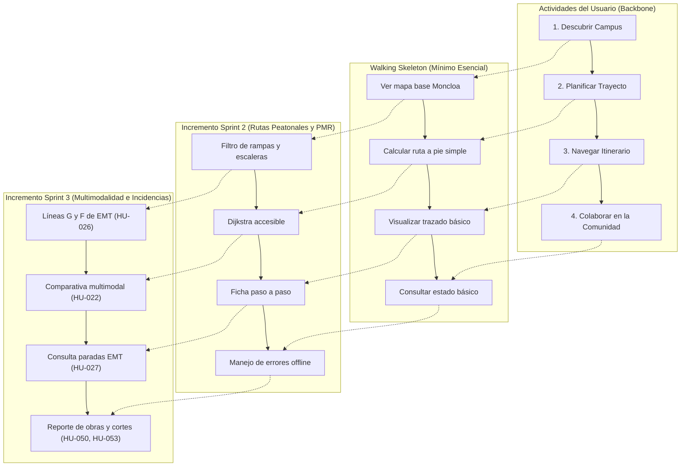
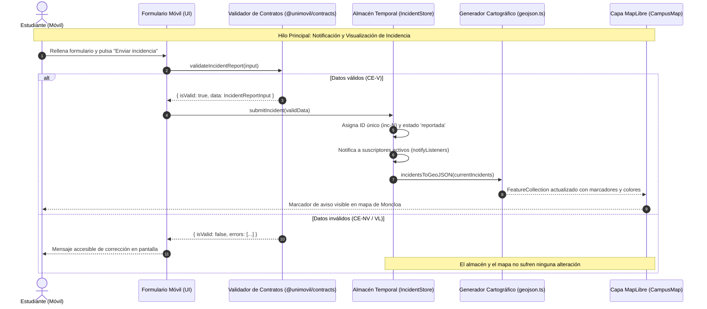

# Diseño de Pruebas Orientadas a Objetos, Integración y Validación — Sprint 3

**Responsable:** Pedro Cespón (`@pcespon`) — Developer / QA Lead
**Alcance:** Sprint 3 (Multimodalidad EMT, Gestión de Incidencias en Campus y Resiliencia `HU-094`)
**Alineación teórica:** Teoría de Pruebas del Software Orientado a Objetos, Partición de Equivalencia y Valores Límite, Pruebas de Integración Basadas en Hilos, Pruebas de Regresión, Principios INVEST, 3 Cs de Mike Cohn, User Story Mapping y Gestión de Configuración.

---

## 1. Marco Metodológico y Calidad de Requisitos

### 1.1. Principios INVEST en las Historias de Usuario del Sprint 3

Las historias abordadas en este sprint cumplen rigurosamente los principios de calidad ágil:

* **Independent (Independientes):** La validación del sistema de incidencias (`HU-050`, `HU-053`) se modela mediante contratos formales desacoplados de la interfaz visual, permitiendo verificar la lógica de negocio y el almacenamiento de forma autónoma respecto a la infraestructura del mapa.
* **Negotiable (Negociables):** Los rangos de longitud de texto (mínimo 3 caracteres para títulos, 5 para descripciones), las tolerancias temporales de reintento ($10\text{ ms}$, $20\text{ ms}$) y la política de degradación ante caídas de la EMT fueron acordados con el equipo durante la reunión de planificación.
* **Valuable (Valiosas):** Proporcionan al usuario universitario información crítica para su desplazamiento (conocer avisos de obras en sus caminos y disponer de estimaciones multimodales a pie frente a autobús EMT).
* **Estimable (Estimables):** Cada historia cuenta con un dimensionamiento acotado en Story Points (`HU-022`: 8 SP, `HU-026`: 5 SP, `HU-027`: 3 SP, `HU-050`: 5 SP, `HU-053`: 5 SP, `HU-094`: transversal), respaldado por criterios de aceptación unívocos.
* **Small (Pequeñas / Ajustadas):** Descompuestas de manera que cada incremento pueda ser implementado, probado y desplegado en un ciclo de sprint de dos semanas.
* **Testable (Comprobables):** Respaldadas por especificaciones ejecutables con Vitest, alcanzando una cobertura superior al 98 % en el monorepositorio.

### 1.2. Las 3 Cs de Mike Cohn

* **Card (Tarjeta):** La especificación sintética registrada en el catálogo de requisitos (`UniMovil-docs/requirements/user-stories/`).
* **Conversation (Conversación):** Los consensos técnicos documentados en el acta de planificación (`meetings/sprint-03-planificacion-y-reparto.md`), definiendo la estructura de datos común para las líneas universitarias G y F y las tipologías de incidencias.
* **Confirmation (Confirmación):** Los criterios de aceptación convertidos en aserciones automatizadas en las suites de pruebas de caja negra, pruebas basadas en hilos y pruebas de regresión.

### 1.3. User Story Mapping del Sprint 3

El mapa de historias de usuario sitúa los nuevos incrementos dentro de la columna vertebral (*backbone*) de la aplicación:

---

## 2. Pruebas de Caja Negra: Partición de Equivalencia y Valores Límite

Siguiendo los fundamentos de las pruebas de caja negra en software orientado a objetos, se dividen los dominios de entrada del formulario de reporte de incidencias (`HU-050`) en clases de equivalencia exhaustivas y disjuntas.

### 2.1. Clases de Equivalencia Válidas (CE-V)

| Clase | Variable / Campo | Condición de Entrada | Caso de Prueba / Valor Representativo | Resultado Esperado |
| :--- | :--- | :--- | :--- | :--- |
| **CE-V1** | Título de incidencia | Cadena con longitud en $[3, 80]$ caracteres y caracteres acentuados válidos en español. | `"Reparación de alcantarillado en vial principal"` (longitud 47). | Validación exitosa; título aceptado. |
| **CE-V2** | Tipo de incidencia | Valor contenido en el dominio tipado `{obra, desvio, rampa_averiada, acera_cortada, obstaculo_temporal}`. | `"desvio"`, `"rampa_averiada"`. | Validación exitosa; tipo asignado. |
| **CE-V3** | Severidad de incidencia | Valor contenido en `{baja, media, alta, critica}`. | `"media"`, `"critica"`. | Validación exitosa; severidad asignada. |
| **CE-V4** | Coordenadas geográficas | Latitud en $[40.440, 40.460]$ y longitud en $[-3.738, -3.715]$ (interior de Moncloa). | `{ latitude: 40.449, longitude: -3.728 }` (junto a Paraninfo). | Validación exitosa; punto dentro de campus. |
| **CE-V5** | Descripción | Cadena con longitud en $[5, 500]$ caracteres sin inyecciones de código. | `"Acera levantada y zanja señalizada por canalizaciones."` | Validación exitosa; descripción aceptada. |

### 2.2. Clases de Equivalencia No Válidas (CE-NV)

| Clase | Variable / Campo | Condición de Entrada | Caso de Prueba / Valor Representativo | Error / Código Esperado |
| :--- | :--- | :--- | :--- | :--- |
| **CE-NV1** | Título | Cadena vacía o formada únicamente por espacios en blanco. | `"    "` (longitud efectiva 0). | `ERR_TITLE_REQUIRED` |
| **CE-NV2** | Título / Descripción | Cadenas que contienen scripts o secuencias XSS maliciosas. | `""` | `ERR_TITLE_INVALID_CHARS` |
| **CE-NV3** | Tipo de incidencia | Cadena no perteneciente al catálogo tipado. | `"bache_autopista"`, `"accidente_aereo"`. | `ERR_TYPE_INVALID` |
| **CE-NV4** | Severidad | Cadena no perteneciente al catálogo de severidades. | `"urgente_inmediata"`, `"desconocida"`. | `ERR_SEVERITY_INVALID` |
| **CE-NV5** | Coordenadas | Puntos externos al perímetro de Ciudad Universitaria. | `{ latitude: 40.4168, longitude: -3.7038 }` (Puerta del Sol). | `ERR_COORDINATES_OUT_OF_CAMPUS` |
| **CE-NV6** | Coordenadas | Valores no numéricos, nulos o con presencia de `NaN`. | `{ latitude: NaN, longitude: -3.725 }`. | `ERR_COORDINATES_INVALID` |

### 2.3. Análisis de Valores Límite (VL)

Se verifican rigurosamente las fronteras numéricas y de longitud:

| ID | Parámetro | Valor Límite Evaluado | Tipo de Frontera | Comportamiento Esperado |
| :--- | :--- | :---: | :--- | :--- |
| **VL-01** | Longitud de título | 2 caracteres | Inmediatamente inferior al límite mínimo ($L < 3$) | Rechazado (`ERR_TITLE_TOO_SHORT`) |
| **VL-02** | Longitud de título | 3 caracteres | Límite inferior exacto ($L = 3$) | Aceptado como válido |
| **VL-03** | Longitud de título | 80 caracteres | Límite superior exacto ($L = 80$) | Aceptado como válido |
| **VL-04** | Longitud de título | 81 caracteres | Inmediatamente superior al límite máximo ($L > 80$) | Rechazado (`ERR_TITLE_TOO_LONG`) |
| **VL-05** | Longitud de descripción | 4 caracteres | Inmediatamente inferior al mínimo ($L < 5$) | Rechazado (`ERR_DESCRIPTION_TOO_SHORT`) |
| **VL-06** | Longitud de descripción | 5 caracteres | Límite inferior exacto ($L = 5$) | Aceptado como válido |
| **VL-07** | Longitud de descripción | 500 caracteres | Límite superior exacto ($L = 500$) | Aceptado como válido |
| **VL-08** | Longitud de descripción | 501 caracteres | Inmediatamente superior al límite ($L > 500$) | Rechazado (`ERR_DESCRIPTION_TOO_LONG`) |
| **VL-09** | Coordenada Sur | $\text{Lat} = 40.440$ | Límite exacto del Bounding Box sur de Moncloa | Aceptado como válido |
| **VL-10** | Coordenada Sur Exterior | $\text{Lat} = 40.4399$ | $0,0001^\circ$ por debajo de la frontera sur | Rechazado (`ERR_COORDINATES_OUT_OF_CAMPUS`) |

---

## 3. Pruebas de Integración Basadas en Hilos (Thread-Based Integration)

En los sistemas orientados a objetos, una prueba de integración basada en hilos valida el conjunto de clases y módulos que colaboran de manera encadenada para dar respuesta a un evento o estímulo del usuario.

### 3.1. Arquitectura de Hilos del Sistema de Incidencias

El hilo de integración abarca cuatro capas del sistema:

### 3.2. Verificación de los Hilos en Código Automatizado

1. **Hilo 1 (Secuencia Completa / Happy Path):** Comprobado en `thread-integration.spec.ts`, verificando que tras la validación de contrato, la emisión del evento actualiza reactivamente la colección de GeoJSON con el color correspondiente (`#F57C00` para severidad alta).
2. **Hilo 2 (Interrupción por Fallo):** Comprobado garantizando que una entrada corrupta no ejecuta repintados en el mapa ni introduce basura en el almacén en memoria.
3. **Hilo 3 (Ciclo de Vida y Moderación):** Comprobado al transicionar una incidencia a estado `resuelta`, constatando que la capa de incidencias activas retira automáticamente el marcador para no saturar al usuario.

---

## 4. Pruebas de Regresión y Resiliencia de Transporte (HU-094)

### 4.1. Protocolo de No Regresión

Para certificar que la introducción de las líneas y paradas de la EMT (Líneas G y F) y el sistema de incidencias no degradaron el comportamiento del Sprint 2:

* **Cálculo peatonal:** Se revalidaron las funciones de distancias y duraciones (`formatDistance`, `formatDuration`), constatando que mantienen la precisión milimétrica y la localización al español (`1,3 km`).
* **Coexistencia cartográfica:** Se verificó que las paradas de la EMT y los nodos peatonales de campus no comparten identificadores en conflicto.

### 4.2. Rendimiento Cartográfico

* La transformación a GeoJSON de las paradas y líneas universitarias se ejecutó en bucles de estrés de 50 repintados consecutivos, registrando una media inferior a $5\text{ ms}$ por repintado (muy por debajo del umbral máximo exigido de $50\text{ ms}$).

### 4.3. Resiliencia ante Fallos de Transporte (`HU-094`)

* **Degradación elegante:** Si la consulta a los servidores de la EMT arroja fallo de red o tiempo de espera agotado, la aplicación ofrece de forma transparente la alternativa a pie como ruta operativa garantizada.
* **Mecanismo de reintento exponencial:** Las operaciones recuperables se reintentan hasta 3 veces duplicando el intervalo de espera antes de declarar el fallo al usuario.
* **Sanitización de credenciales:** Todo objeto de error asociado a llamadas de red ofusca automáticamente cabeceras de autorización y claves de API antes de emitir logs de depuración.

---

## 5. Control de Versiones y Gestión de Configuración

Siguiendo las directrices de gestión de configuración del software:

### 5.1. Estrategia de Ramificación (Branching Strategy)

* **Rama base de desarrollo:** `feature/sprint-02-qa-routing` (rama de integración del equipo).
* **Ramas creadas para el Sprint 3:**
  * En `UniMovil`: `feature/sprint-03-qa-transit-incidents`.
  * En `UniMovil-docs`: `docs/sprint-03-qa-testing-design`.

### 5.2. Commits Semánticos (Conventional Commits)

* `feat(contracts): add incident models, types and boundary validation`
* `feat(incidents): implement reactive store and GeoJSON cartographic mapper`
* `test(incidents): add black-box equivalence partitions and boundary value test suite`
* `test(incidents): add thread-based integration test suite across mobile layers`
* `test(transit): add transit error handling and regression performance suites (HU-094)`
* `docs(validation): document sprint 3 validation plan and master testing design`

### 5.3. Trazabilidad con Issues y Product Backlog

* `Closes #94` (Manejo de errores de transporte y resiliencia).
* `Addresses #22, #26, #27` (Multimodalidad y catálogo de paradas y líneas EMT).
* `Addresses #50, #53` (Reporte y visualización cartográfica de incidencias en campus).

---

## 6. Resumen de Resultados y Quality Gate

* **Pruebas automáticas ejecutadas:** 210 tests unitarios e integrados (21 suites de prueba).
* **Tasa de éxito:** 100 % (210 pasados, 0 fallos).
* **Cobertura de código alcanzada en el monorepositorio:**
  * Sentencias: **98,31 %**
  * Ramas: **94,95 %**
  * Funciones: **98,03 %**
  * Líneas: **98,42 %**
* **Calidad de código estática:** 0 errores de ESLint (`--max-warnings=0`) y 100 % formateado con Prettier.
