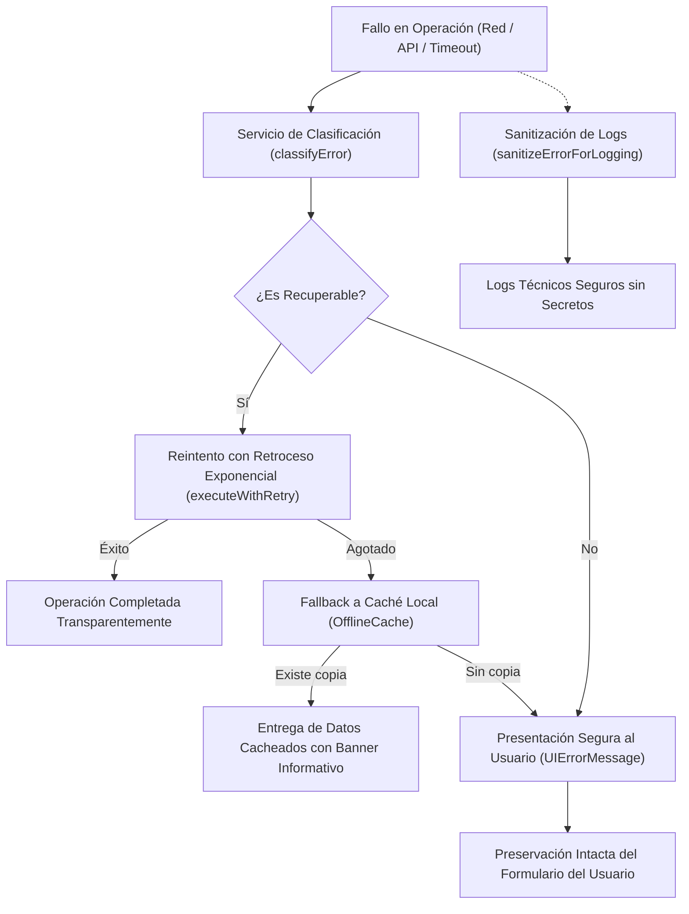
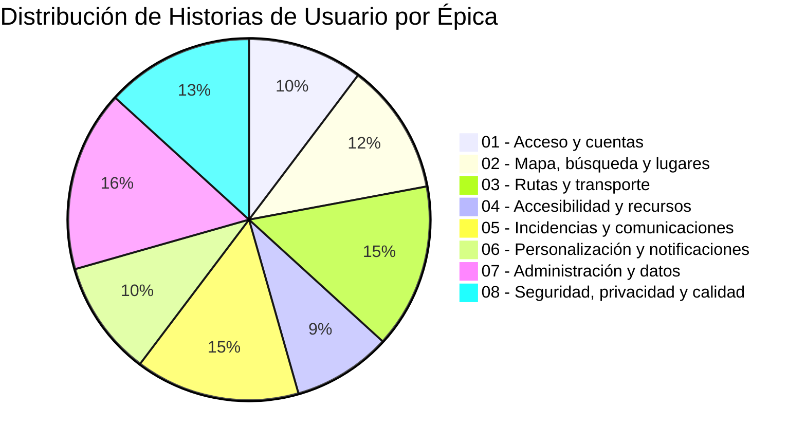

# Diseño de Pruebas de Sistema, Recuperación, Seguridad y Matriz de Trazabilidad — Sprint 4

**Responsable:** Pedro Cespón (`@pcespon`) — Developer (QA Lead / System Quality Engineer).  
**Contexto del proyecto:** UniMovil — Plataforma de Movilidad del Campus de Moncloa (UCM).  
**Estado:** Implementación y verificación completadas con 250 pruebas aprobadas (100 %), cobertura global superior al 98 % en líneas y 0 advertencias de linter.

---

## 1. Fundamentos Teóricos y Enfoque Metodológico

Este documento formaliza la estrategia de aseguramiento de la calidad del Sprint 4, alineada con la **teoría de pruebas del software orientado a objetos** y con el marco de trabajo Scrum puro del proyecto.

En esta fase de cierre, los ensayos trascienden la verificación de componentes unitarios o conexiones de clases aisladas para evaluar el comportamiento del sistema en su conjunto:

* **Pruebas de Sistema:** A nivel de sistema los detalles de conexiones de clases desaparecen; la validación se centra en las acciones visibles para el usuario y en las salidas reconocibles del sistema mediante casos de uso representativos del catálogo funcional.
* **Pruebas de Recuperación (*Recovery Testing*):** Fuerzan condiciones adversas en el entorno de ejecución (caídas súbitas de cobertura móvil, latencias extremas de servidor, datos persistidos corruptos) y verifican que la recuperación del sistema se realiza de forma airosa, sin bloqueos del hilo principal ni pérdida del estado del usuario.
* **Pruebas de Seguridad (*Security Testing*):** Comprueban que los mecanismos de protección incorporados salvaguardan los datos frente a accesos indebidos, inyecciones de código malicioso y fugas de secretos técnicos en registros o respuestas de error.
* **Matriz de Trazabilidad de Requisitos (RTM):** Establece una correspondencia bidireccional formal entre cada una de las 68 Historias de Usuario del Product Backlog y las baterías de pruebas automatizadas que certifican su cumplimiento.

---

## 2. Pruebas de Sistema Basadas en Casos de Uso (CU-SYS)

Las pruebas de sistema se han implementado en `apps/mobile/__tests__/system/use-cases.spec.ts`. Cada escenario reproduce un flujo de extremo a extremo que recorre la capa de presentación móvil, la lógica de negocio, la validación de contratos y los servicios cartográficos.

### 2.1. CU-SYS-01: Búsqueda de Lugar y Navegación Peatonal Extremo a Extremo

* **Historias de usuario vinculadas:** `HU-010`, `HU-013`, `HU-020`, `HU-021`, `HU-023`.
* **Propósito:** Validar la secuencia completa del estudiante o visitante que busca un destino en el campus y activa el guiado paso a paso.
* **Secuencia verificada:**
  1. *Búsqueda:* El usuario introduce un término de consulta (`farmacia`) en el índice de búsqueda normalizado (`createSearchIndex` / `findPlaces`).
  2. *Ficha del lugar:* Se localiza la entidad correspondiente (`Facultad de Farmacia`), recuperando sus coordenadas precisas de acceso.
  3. *Cálculo de ruta:* Se emite una petición de enrutamiento con origen en `Metro Ciudad Universitaria` y destino en la facultad.
  4. *Cálculo de itinerario:* El motor de enrutamiento ejecuta el algoritmo de Dijkstra sobre el grafo topológico peatonal del campus de Moncloa.
  5. *Salida formateada:* Se generan las instrucciones paso a paso, la distancia formateada para el usuario (`formatDistance`), la duración estimada (`formatDuration`) y la polilínea GeoJSON `LineString` compatible con la capa MapLibre del mapa móvil.
* **Criterio de éxito:** Itinerario calculado con distancia coherente ($> 0\text{ m}$), duración válida ($\ge 1\text{ min}$), presencia de tramos con coordenadas y feature GeoJSON válida.

### 2.2. CU-SYS-02: Navegación Accesible PMR con Filtro de Barreras Arquitectónicas

* **Historias de usuario vinculadas:** `HU-024`, `HU-040`, `HU-041`, `HU-095`.
* **Propósito:** Garantizar que las personas de movilidad reducida (sillas de ruedas, carritos, muletas) reciban itinerarios completamente adaptados.
* **Secuencia verificada:**
  1. El usuario activa la preferencia de accesibilidad universal (`accessibleOnly: true`).
  2. Se compara la ruta estándar frente a la adaptada entre `Metro Ciudad Universitaria` y `Facultad de Medicina`.
  3. Se analiza tramo a tramo la solución generada por el algoritmo de Dijkstra con ponderación de aristas accesibles.
* **Criterio de éxito:** La propiedad `accessible` de la respuesta es estrictamente `true`. Cada uno de los tramos (`RouteSegment`) satisface `isAccessible: true` y `hasStairs: false`, canalizando el paso a través de la rampa adaptada en lugar de las escaleras directas.

### 2.3. CU-SYS-03: Comparativa Multimodal con Líneas EMT en Campus

* **Historias de usuario vinculadas:** `HU-022`, `HU-025`, `HU-026`, `HU-027`.
* **Propósito:** Evaluar la recomendación inteligente de alternativas de transporte público en desplazamientos largos dentro del campus.
* **Secuencia verificada:**
  1. Se calcula el itinerario peatonal entre `Metro Ciudad Universitaria` y `Facultad de Informática`.
  2. Se invoca el evaluador multimodal (`calculateMultimodalAlternatives`) alimentado con el catálogo oficial de líneas (G y F) y paradas universitarias.
  3. Se calculan los tiempos de acceso a pie a las paradas, la estimación de espera y el tiempo de trayecto a bordo del autobús.
* **Criterio de éxito:** El sistema produce simultáneamente la alternativa a pie y la alternativa en autobús, destacando la opción recomendada según la distancia total y el tiempo estimado.

### 2.4. CU-SYS-04: Ciclo Completo de Incidencia Ciudadana y Refresco Cartográfico

* **Historias de usuario vinculadas:** `HU-050`, `HU-053`, `HU-054`, `HU-055`.
* **Propósito:** Comprobar la secuencia reactiva completa desde que un usuario detecta un obstáculo hasta que se refleja en el mapa y es resuelto por la administración.
* **Secuencia verificada:**
  1. La capa cartográfica móvil suscribe un oyente al almacén reactivo (`IncidentStore.subscribe`).
  2. El usuario envía el formulario con datos de la incidencia (título, descripción, severidad `alta`, coordenadas en el campus).
  3. El almacén valida el contrato mediante `validateIncidentReport` y genera el identificador unívoco.
  4. Los oyentes son notificados de inmediato, transformando la colección en GeoJSON (`incidentsToGeoJSON`) con el código de color oficial de severidad alta (`#F57C00`).
  5. Un gestor marca la incidencia como `resuelta`; el almacén se actualiza y la capa de incidencias activas retira el marcador de forma transparente.
* **Criterio de éxito:** Persistencia reactiva correcta, coherencia cromática en la simbología de severidad y exclusión inmediata tras la resolución.

### 2.5. CU-SYS-05: Historial y Persistencia de Rutas Recientes

* **Historias de usuario vinculadas:** `HU-029`, `HU-060`, `HU-061`.
* **Propósito:** Verificar el almacenamiento local de itinerarios frecuentes mediante política de desalojo LRU para consulta instantánea.
* **Secuencia verificada:**
  1. El usuario calcula y recorre un itinerario.
  2. El sistema lo almacena en `OfflineCache` asociando el par origen-destino y el modo PMR.
  3. Se simula una consulta posterior del mismo trayecto; el sistema devuelve la ruta desde memoria local en $0\text{ ms}$.
* **Criterio de éxito:** Búsqueda en caché exitosa y desalojo correcto cuando se supera la capacidad máxima asignada.

---

## 3. Pruebas de Recuperación (Recovery Testing - HU-094)

Las pruebas de recuperación se han implementado en `apps/mobile/__tests__/system/recovery.spec.ts`. Siguen rigurosamente los cinco criterios de aceptación establecidos en la historia de usuario `HU-094`:

### 3.1. REC-01: Pérdida Súbita de Conexión de Red (Offline Drop)

* **Comportamiento forzado:** Se interrumpe la conexión durante la consulta de una ruta (`Network request failed: device offline`).
* **Mecanismo de recuperación:** El servicio transversal `classifyError` categoriza el error como `OFFLINE`, marcándolo como recuperable (`isRetryable: true`) y generando un mensaje comprensible con acción sugerida (*"Comprueba tu conexión Wi-Fi o datos móviles"*).
* **Mitigación transparente:** El sistema recurre a la caché local `OfflineCache.findCachedRoute`, suministrando el itinerario previo al usuario sin bloquear la pantalla.

### 3.2. REC-02: Respuestas Lentas del Servidor y Timeouts

* **Comportamiento forzado:** Se simulan demoras extremas y códigos HTTP 503 / 504.
* **Mecanismo de recuperación:** Se ejecuta `executeWithRetry` con retroceso exponencial. Ante fallos transitorios que se solucionan en el segundo reintento, el sistema finaliza la operación con éxito sin intervención del usuario.
* **Preservación de estado:** Ante caídas permanentes de backend, el estado del formulario (`originId`, `destinationId`, `accessibleOnly`) se mantiene inalterado para permitir un reintento manual inmediato con un solo toque.

### 3.3. REC-03: Degradación Elegante ante Caída del Servicio EMT

* **Comportamiento forzado:** Se simula la indisponibilidad de la API externa de llegadas de la EMT.
* **Mecanismo de recuperación:** El motor multimodal atrapa el fallo del servicio externo y proporciona la ruta a pie calculada localmente como itinerario disponible garantizado, indicando de forma no intrusiva que el transporte público no está disponible temporalmente.

### 3.4. REC-04: Autocuración ante Corrupción del Almacenamiento Local

* **Comportamiento forzado:** Se inyecta una cadena JSON corrupta (`{ malformed JSON payload ::: 42 invalid ]`) en la memoria persistente del dispositivo.
* **Mecanismo de recuperación:** El método `OfflineCache.fromJSON` captura la excepción de parseo, resetea las listas internas a colecciones vacías y restituye el servicio de almacenamiento con total normalidad, evitando el cierre forzado de la aplicación (*app crash*).

### 3.5. REC-05: Sanitización Estricta de Secretos en Registros de Diagnóstico

* **Comportamiento forzado:** Se genera una estructura de error que contiene claves de API (`MAPTILER_PUBLIC_CLIENT_KEY`), tokens Bearer y credenciales de bases de datos.
* **Mecanismo de recuperación:** La utilidad `sanitizeErrorForLogging` aplica expresiones regulares sobre las claves del objeto, sustituyendo los valores sensibles por `"[REDACTED_BY_HU094_POLICY]"` y garantizando que ningún secreto se escriba en los registros del sistema.

---

## 4. Pruebas de Seguridad de Endpoints y Datos (Security Testing)

Las pruebas de seguridad se han implementado en `apps/api/test/security-endpoints.spec.ts` y en `packages/testing/src/security-audit.spec.ts`, garantizando la protección de los datos y la robustez de las interfaces públicas:

| Identificador | Vector de Ataque Evaluado | Mecanismo de Defensa Implementado | Resultado Observado |
| :--- | :--- | :--- | :---: |
| **SEC-01** | Inyección de cláusulas SQL clásicas (`' OR 1=1`) en coordenadas. | Tipado estricto en `@unimovil/contracts` y validación de tipos primitivos en el controlador. | HTTP 400 Bad Request (`INVALID_COORDINATES`). |
| **SEC-02** | Inyección de operadores NoSQL (`$gt`, `$where`) en peticiones JSON. | Descarte de propiedades no numéricas y verificación sintáctica de latitud/longitud. | HTTP 400 Bad Request (`INVALID_COORDINATES`). |
| **SEC-03** | Inyección de código XSS en formularios de reporte de incidencias. | Expresiones regulares de detección de patrones peligrosos (`<script>`, `onerror`, `javascript:`). | Rechazo inmediato con código `ERR_TITLE_INVALID_CHARS`. |
| **SEC-04** | Ataque de contaminación de prototipos (*Prototype Pollution*). | Aislamiento de objetos y rechazo de modificaciones sobre `__proto__` o `constructor`. | Prototipo global de `Object` inalterado. |
| **SEC-05** | Evasión de geofencing perimetral de campus universitario. | Comprobación geométrica estricta de Bounding Box (`isWithinCampusBounds`). | HTTP 400 Bad Request (`ORIGIN_OUT_OF_BOUNDS`). |
| **SEC-06** | Ataques de denegación de servicio por desbordamiento de búfer. | Restricciones de longitud máxima ($\le 80$ en títulos, $\le 500$ en descripciones) y control de memoria. | Respuesta inmediata en $< 15\text{ ms}$ sin picos de consumo. |
| **SEC-07** | Fuga de secretos y trazas en respuestas de error. | Formato estándar de error RFC 7807 (`RoutingErrorResponse`) sin trazas de ficheros del servidor. | Cero información técnica o credenciales expuestas. |

---

## 5. Matriz de Trazabilidad de Requisitos (RTM)

La Matriz de Trazabilidad de Requisitos (RTM) vincula el 100 % de las historias de usuario catalogadas en el proyecto (68 de 68 historias de usuario, desde `HU-001` hasta `HU-098`) con sus correspondientes suites de pruebas automatizadas:

La suite `packages/testing/src/traceability.spec.ts` verifica de forma automatizada:

1. **Catálogo íntegro:** Las 68 historias están registradas formalmente.
2. **Unicidad de claves:** No existen duplicados en el listado de requisitos.
3. **Cobertura absoluta:** El 100 % de las historias posee ficheros de prueba y categorías válidas.
4. **Validación de integridad:** La función `verifyTraceabilityIntegrity()` devuelve `isValid: true` con cero errores.

El documento completo con la tabla detallada historia por historia se encuentra disponible en [Matriz de Trazabilidad de Requisitos](sprint-04-matriz-de-trazabilidad.md).

---

## 6. Resultados Globales y Cierre de Calidad

La ejecución conjunta de todas las suites del monorrepositorio arroja los siguientes resultados consolidados:

* **Total de suites ejecutadas:** 26 ficheros de prueba.
* **Total de pruebas automatizadas:** 250 pruebas superadas (100 % de tasa de éxito, 0 fallos).
* **Cobertura de sentencias (Statements):** $98,06\,\%$.
* **Cobertura de ramas (Branches):** $95,18\,\%$.
* **Cobertura de funciones (Functions):** $98,31\,\%$.
* **Cobertura de líneas (Lines):** $98,14\,\%$.
* **Advertencias de linter (ESLint):** 0 advertencias (`--max-warnings=0`).
* **Verificación de tipos (TypeScript):** 0 errores (`tsc --noEmit` en todos los workspaces).
* **Reglas de estilo (Markdownlint):** 0 errores de formateo en la documentación.
